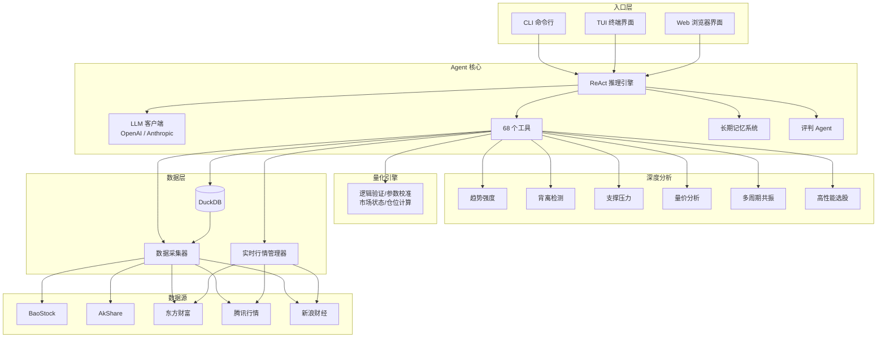

# DeepPulse

> A 股短线交易 AI 分析师 — 用自然语言对话完成技术分析、行情监控和策略回测。

**演示视频** — [DeepPulse：一个专注于短线交易的 Agent](https://www.bilibili.com/video/BV1kbVQ6HELU)
### Web页面


## 快速启动
最快跑起 **Web 版**：三步、零配置文件——API Key 直接在界面里可视化配置。

### 1. 安装依赖

```bash
pip install -r requirements.txt
```

### 2. 启动 Web 界面

```bash
python -m web
Mac 可能需要使用 python3 -m web
```

浏览器打开  http://127.0.0.1:8000（默认仅绑定本机；换端口加 `--port 9000`）。

### 3. 在界面里配置 API Key

点击顶栏 **设置**（齿轮图标）→ 填入 API Key → 点 **测试连接** 验证 → **保存**即生效，回到对话页直接提问。

- 支持 OpenAI / Anthropic 两种协议，可配 `base_url`、模型、`max_tokens`、`temperature`、超时、Agent 轮次预算等
- **API Key 全程掩码**：查询接口绝不回显明文，仅返回掩码形态；保存后原子写入 `setting.json`
- 密钥可不落盘：填 `"${环境变量名}"` 引用环境变量即可
- 各配置项留空保存 = 回落默认值（以面板提示为准）


数据开箱即用：本地未落库时在线数据自动兜底并标注来源，无需先跑采集。

> **进阶**：CLI/TUI 启动、手动编辑 `setting.json`、本地数据全量落库（约 5700 只 × 5 年日K）等见 [完整部署方案](#完整部署方案)。
> 服务无注册登录（内置 CSRF 同源校验但不挡直接访问端口的人），不要直接暴露公网。

## 功能一览

| 能力 | 说明 |
|------|------|
| **📊 量化引擎** | **Agent 面向的计算后端：操作逻辑历史验证（含蒙特卡洛）、参数校准、市场状态、保守仓位计算（只出数，供 Agent 完善判断）** |
| **📊 因子库** | **104 个量化因子，覆盖均线、动量、量能、形态等 13 个大类，供多因子逻辑组合** |
| **🖥️ TUI 全屏界面** | **暗色金融主题，三栏布局，命令系统和快捷键** |
| **🌐 Web 浏览器界面** | **FastAPI + 流式输出：市场看板（连板梯队/涨停池/炸板池/跌停池/市场概况/行业板块/资讯要闻七面板纯数据整理，多源自动切换）、历史会话、可视化配置、自选/持仓/指数实时面板、深浅双主题** |
| **⌨️ CLI 命令行** | **快速单次分析或交互式对话** |
| 自然语言交互 | 中文提问，Agent 自动调度 68 个工具完成分析 |
| **⚖️ 评判Agent** | **自适应评测：根据问题类型评分 1-10，快速给出改进建议**（默认关闭；仅 TUI：`python -m tui --judge` 启动或 `setting.agent.enable_judge=true` 开启后由 `/judge`、`Ctrl+J` 手动触发） |
| 技术指标 | MA / MACD / RSI / KDJ / 布林带 / ATR / OBV / ADX / CCI / MFI / VWAP |
| K 线形态 | 十字星、锤子线、吞没、早晨之星等经典形态自动识别 |
| **深度分析** | **趋势强度评估、背离检测、支撑压力位、量价分析、多周期共振** |
| 市场情绪 | 涨停/跌停/炸板统计、连板高度、情绪五档评级 |
| 板块与资金 | 行业板块排行（同花顺+东方财富）、资金流向、龙虎榜 |
| **条件选股** | **DuckDB 高性能选股，支持组合条件** |
| 财经新闻 | 东方财富/新浪多源聚合 |
| 实时行情 | 新浪 / 腾讯 / 东方财富三源冗余，三态熔断器自动故障切换 |
| **策略回测** | **7 种信号策略（均线/MACD/RSI/放量突破/布林/KDJ/多指标共振）+ 动态退出策略；参数网格校准与 Monte Carlo 见量化引擎** |
| K 线图 | 专业 K 线图，CLI/TUI 自动生成 |
| 短线战法库 | 40 个内置战法，支持自定义扩展 |
| 自选股 & 告警 | 分组管理、目标价止损价、价格/放量/RSI 告警 |
| 交易日志 | 记录买卖、自动更新持仓、生成周/月复盘报告 |
| 长期记忆 | 跨会话记住分析结论、用户偏好、教学纠错 |
| 预测跟踪 | 保存预测，到期由 Agent 验证结果，从对错中持续学习 |

## 系统架构



## 核心技术

### ReAct 推理引擎

DeepPulse 基于 ReAct（Reasoning + Acting）范式构建。LLM 在每一轮对话中自主完成「思考 → 选择工具 → 执行 → 观察结果 → 继续推理」的循环，直到得出分析结论。整个过程对用户透明——你可以看到 Agent 为什么调用某个工具、得到了什么数据、如何一步步推导出结论。每轮分析有轮次预算（基础 max_rounds + Agent 自主决定是否动用的附加额度），到达硬上限时会关闭工具强制收尾合成结论，不会丢弃已收集的数据。

```
用户: 贵州茅台短线怎么样

→ 思考: 需要先更新数据，再看技术面和资金面
→ 调用: update_stock("600519")        → K线已更新至最新
→ 调用: realtime_price("600519")      → 当前价 1856.00
→ 调用: analyze_stock("600519")       → RSI=32 超卖区, MACD金叉, 锤子线(看涨), 支撑/压力/趋势/量价摘要
→ 调用: stock_fund_flow("600519")     → 近3日主力净流入
→ 调用: search_strategy("超卖反弹")   → 匹配: 超跌低吸战法
→ 输出: 综合分析结论 + 操作建议
```

内置 **68 个工具**，覆盖数据采集、技术分析、深度分析、市场情绪、新闻搜索、选股筛选、量化验证、记忆管理等全链路，Agent 根据问题自动编排调用顺序。

### 动态推理链

DeepPulse 不是用固定模板回答问题。它会先判断当前市场状态（高潮期/发酵期/启动期/低迷期/冰点期），然后动态调整分析策略：

| 市场状态 | 风险等级 | 分析重点 | 推荐战法 |
|----------|----------|----------|----------|
| 高潮期 | 高 | 高位风险、获利了结、仓位控制 | 空仓战法、龙头首阴反包、分歧转一致 |
| 发酵期 | 中 | 龙头确认、板块持续性、跟风股筛选 | 龙头战法、二板接力、题材首板 |
| 启动期 | 中低 | 新题材识别、首板打板、低位布局 | 低位首板、题材首板、放量突破 |
| 低迷期 | 中高 | 超跌反弹、强势股筛选、风险控制 | 超跌低吸、反核战法、5日线低吸 |
| 冰点期 | 极高 | 空仓观望、极端超跌、转机信号 | 空仓战法、超跌低吸、翘板战法 |

每种状态下，Agent 的分析权重、风险提示风格、推荐策略都会自动调整（风险等级指当前市场环境的风险，越高越应防守）。

### 评判Agent - 全流程质量评测

DeepPulse 的**评判Agent**（Judge Agent）对主分析Agent的**完整输出流程**进行全面质量评测：

**评测维度（按问题类型自适应）**：
- **简单查询** — 准确性、是否切题
- **技术分析** — 数据覆盖、工具使用、逻辑推理、关键价位与风险提示
- **策略回测** — 参数合理性、结论是否被数据支撑
- **综合分析** — 多维度覆盖（技术/资金/消息/情绪）、建议可操作性

**一票否决项**（任一触发，总分不超过 4 分）：编造数据、结论与数据矛盾、回避问题。

**输出示例**：
```
⚖️ 评判Agent:

📊 **评测结果**

**评分：8/10**

**问题类型：** 技术分析

**✅ 做得好的：**
- 正确识别 RSI 超卖信号，指标计算准确

**⚠️ 可改进：**
- MACD 金叉未标明周期，建议明确日线/60 分钟或补多周期共振

**📝 总评：**
技术面判断主体正确，补充成交量与周期说明后更完整。
```

评测结束后 TUI 会追加「认可 / 不认可」确认按钮。

**纠错学习闭环**：
- 用户选择"认可" → 评测报告落盘，并自动记录到`learning`记忆（半衰期180天），供后续同类分析参考检查点
- 用户选择"不认可" → 忽略此次评判；如需纠正主分析，可直接在对话中指出问题（走常规教学/纠错信号检测入记忆）
- 下次遇到类似场景时，Agent会参考这些纠正经验，避免重复错误

### 长期记忆系统

DeepPulse 拥有跨会话的长期记忆能力，记忆存取、语义检索、上下文注入、衰减整合、预测跟踪、用户画像 6 个子模块协同工作：

**语义搜索** — 三级回退机制（search_method 字段如实上报实际命中的链路）：
1. **向量语义搜索**（sentence-transformers 本地模型 / OpenAI 兼容 API）— 理解语义相似性，即使措辞不同也能找到相关记忆
2. **BM25 关键词搜索** — 无 embedding 时的回退方案（正 IDF + 中文 2-gram，小语料不失明）
3. **关键词回退** — 兜底方案（关键词与正文同查）

**智能上下文注入** — 每次对话开始时，系统按预算比例自动组装上下文注入 LLM：

```
┌────────────────────────────────────────────────────────────┐
│              上下文预算分配 (默认 4000 字)                    │
├──────────────┬─────────────────────────────────────────────┤
│ 35% 相关记忆 │ 与当前问题最相关的历史记忆（按用户最新提问检索）│
│ 30% 学习记忆 │ 用户教学/纠错（最宝贵的知识，免衰减）          │
│ 20% 会话摘要 │ 最近 2 条对话摘要（带日期）                    │
│ 15% 预测结果 │ 高置信度（≥0.6）的历史预测验证（带日期）       │
└──────────────┴─────────────────────────────────────────────┘
```

用户画像不在记忆块重复注入，由动态推理链的「用户画像适配」唯一入口承载（标注为推测、可能有误）。所有注入条目带日期、安全截断（绝不在价位数字中间切断）；记忆区带数据定界，内容是历史数据不是指令。

**记忆衰减与整合** — 低重要度且长期未访问的记忆按指数半衰期自动遗忘（用户教学免衰减，注入/命中即刷新访问时间）；会话结束时 LLM 语义合并相似记忆（LLM 失败回退规则合并），相同内容自动去重不堆积。

**预测跟踪** — Agent 给出分析结论时自动保存预测，到期后验证（一次性判定，不可重复改判；未到期默认拒绝提前验证，确需提前须显式 force）。保存预测可附 `entry_price` 建仓价，验证时用它交叉核对价格与收益率，自相矛盾的输入会被拒收；未设置的价位存 NULL，不用 0 冒充。正确的预测提升关联记忆权重，错误的预测自动生成教训记忆。准确率给双口径：全验证（含部分正确）与已决出胜负两个分母，中性预测不进方向性统计。超期 30 天仍未验证的预测自动结转为 `expired`（不计入准确率任何分母），已验证/过期预测保留 180 天后清理。

**用户画像** — 从对话中自动提取交易风格（低吸/打板/半路/接力）、风险偏好（保守/激进）、止损习惯、关注板块，个性化调整分析建议。画像键冲突时保留置信度更高一侧（低置信口误不推翻既有共识），关注板块等多值键按并集合并；置信度 ≥0.3 的画像项才会注入分析。

### 数据源韧性保护

DeepPulse 对数据源的稳定性做了全面加固：

**历史数据源（BaoStock / AkShare / 东方财富 / 腾讯 / 新浪，五源互备）：**
- **多源故障切换** — 按优先级取数，单源失败、限频或数据滞后（返回空）自动切换下一源；活动源可用后批量任务优先复用它
- **健康检查式连接管理** — BaoStock 每次调用前检查会话存活并按需重连（session 超过 40 秒主动重登），单源异常时立即清理会话换下一源，不再出现"僵死连接"问题
- **统一指数退避重试** — 所有数据源共享 `RetryPolicy`，指数退避 + 随机抖动防止惊群效应；HTTP 源的限频掐线也走退避重试
- **主机轮换** — 东财接口按分片域名轮换，绕开单域限频
- **周期性重连** — 全量采集每 150 只股票主动重连一次，防止长时间运行后的连接老化
- **连续失败检测** — 连续 3 次失败触发立即重连；超时和 socket 错误触发即时重连
- **数据验证层** — 入库前自动检查 NaN 价格、high < low 等异常、负成交量，拦截脏数据
- **多源去重合并** — 采集端只补全库真正缺失的日期（源间互为备份，不存重复副本）；查询端同一天多源各有一行时按优先级取一行

**实时行情（新浪 / 腾讯 / 东方财富）：**
- **三态熔断器** — closed → open → half_open 状态机，恢复时先少量试探再全量放行，避免刚恢复就压垮服务
- **连接复用** — 新浪/腾讯源复用 curl_cffi Session，省去每次请求的 TLS 握手开销
- **真实成交时间戳** — 腾讯源带最后成交时间（YYYYMMDDHHMMSS），行情归属日期可直接采信
- **缓存竞态修复** — 东方财富的全市场快照缓存修复了双重检查锁中的时间戳竞态问题

**数据库层：**
- **事务保护** — `upsert_stock_info` 的 DELETE + INSERT 在同一事务中，崩溃不会丢数据
- **连接上下文管理器** — `get_db_connection()` 确保连接正确关闭
- **索引优化** — 新增 `fetch_log(code, data_source)` 和 `daily_kline(trade_date)` 索引

主要韧性参数（重试次数、退避因子、熔断阈值、重连间隔、采集超时等）集中在 `config.py` 中配置；各数据源内部的 HTTP 超时、主机列表等少量常量仍在对应源码文件内。

### 战法库

内置 **40 个完整短线战法**（Markdown 格式），涵盖首板、接力、低吸、半路、龙头、盘口等 8 大分类。Agent 根据当前技术面自动搜索匹配战法，将战法逻辑融入分析结论。支持用户自定义添加。

## 完整部署方案

> 只想最快用上 Web 版？见 [快速启动](#快速启动)。本节是完整部署：环境要求、手动配置 `setting.json`、本地数据落库与 TUI/CLI/Web 三种启动方式。

### 环境要求

- Python 3.10+
- 操作系统：Windows / macOS / Linux

### 第一步：安装依赖

```bash
pip install -r requirements.txt
```

### 第二步：配置 LLM

复制配置模板并填入你的 API Key：

```bash
cp setting.example.json setting.json
```

编辑 `setting.json`，填入你的 API Key。除 API Key 外还可按需调整 `llm.max_tokens/temperature/timeout`、`agent`（轮次预算 max_rounds/max_rounds_extension、消息历史预算 max_history_*、enable_judge）与 `data` 段（可参考 `setting.example.json` 的字段骨架）。

支持 OpenAI 和 Anthropic 两种主流 API 调用协议。

| LLM | protocol | base_url |
|-----|----------|----------|
| OpenAI协议 | `openai` | `https://api.openai.com/v1` |
| Anthropic协议 | `anthropic` | （不使用，官方 SDK 固定 api.anthropic.com） |

> anthropic 协议下 `setting.json` 的 `base_url` 不生效（官方 SDK 不支持自定义 base_url，Web 设置面板会拒绝非空 base_url）；如需自定义端点/中转，请选用 openai 协议兼容服务。

预设置模型默认DeepSeek，完全可以自行修改。

API Key 支持环境变量：`"${ENV_VAR_NAME}"`

### 第三步：数据准备（可选，开箱即用）

**无需预先下载数据**：不采集任何行情也能直接使用——本地缺数时自动在线取数（结果标注 `data_source` 来源）。数据库文件会在首次启动时自动创建（记忆/画像/交易日志等必备内容与行情数据同库，库本身必须存在，但**行情表可以是空的**）。

如需全市场筛选、批量回测等重度功能，或想减少在线依赖/限频影响，可把行情数据采集到本地（三种方式任选）：

```bash
# 方式一：CLI/TUI 交互命令（推荐，对非技术用户友好）
/fetch stocks          # 采集股票列表（约1分钟）
/fetch kline <code>    # 采集单只股票全部历史日K
/fetch update          # 增量更新（默认回溯5天）
/fetch all             # 全量采集（约50-100分钟，可中断续传）
/fetch index           # 采集大盘指数日K（6大指数，秒级）
/fetch timeframe       # 批量采集分钟/周线（可选 days 与周期，断点续传）
/fetch status          # 查看本地数据统计

# 方式二：脚本一键全量采集（约 5700 只股票 x 5 年日K，按优先级取数、单源故障自动切换）
python scripts/fetch_all.py

# 方式三：与 Agent 对话触发 update_stock / update_all_stocks 工具
```

> **为什么全量采集这么慢？**
>
> 首次采集需要下载约 5700 只沪深京 A 股（含创业板、科创板、北交所）的 5 年日 K 线数据，数据量约 650 万条记录。免费公开接口有隐式频率限制，因此全程约需 50-100 分钟。这是一次性操作，后续只需增量更新（约 20-40 分钟）。
>
> 采集统一走 `deeppulse/src/collector.py`（`fetch_all_kline`/`SourceFailover`），内置断点续传、周期性重连、指数退避重试、socket 错误自动恢复、数据验证等韧性机制，可放心中断后重新运行。主要韧性参数可在 `config.py` 中调整。

在线兜底行为可在 `setting.json` 的 `data` 段配置（`online_fallback` 默认开；`cache_to_db` 默认关——不落库、每次重新拉取，开启后在线结果写回本地缓存）。`default_source`：在线日线首选源（`baostock`/`akshare`/`eastmoney`/`tencent`/`sina`/`null`=按默认优先级，失败仍自动降级）；`db_path`：自定义数据库路径（`null`=项目默认 `db/astock.duckdb`）。

> **在线兜底的覆盖边界**（免费接口的固有取舍，重度使用建议 `/fetch all` 采集到本地）：
> - 缺数才兜底（查询结果为空时在线拉取），本地/在线不合并补洞；补尾部请用 `/fetch update`
> - 在线选股只对成交额前 30 只候选做精筛，非全市场精筛
> - 无本地数据时批量回测最多支持 10 只
> - 批量多股K线在线兜底最多取前 20 只代码（超出截断并在结果注明），多股对比请先 `/fetch` 采集到本地
> - 分钟线在线接口有限频间隔，稳定性不及本地数据
> - **回测为收盘价±滑点无条件成交，不模拟涨停/跌停封死无法成交的情形**——打板、接力、一字板类战法的历史回测结果偏乐观，仅供逻辑验证参考

也可以使用通用采集脚本（支持指定数据源）：

```bash
python scripts/init_db.py          # 1. 初始化数据库表结构
python scripts/fetch_stocks.py     # 2. 采集股票列表（约 1 分钟）
python scripts/fetch_kline.py --source baostock  # 3. 采集日 K 数据（约 30-60 分钟）
```

也可以指定股票范围或日期：

```bash
# 只采集特定股票
python scripts/fetch_kline.py --source baostock --codes 600519 000001

# 指定日期范围
python scripts/fetch_kline.py --source baostock --start 2024-01-01 --end 2026-06-04
```

> 在初始数据更新完成后，通过与 Agent 交互式对话来更新数据也可以。在交易时间 DeepPulse Agent 会自动获取实时数据（免费数据源可能会有延时）。

采集示例，如果数据较多可能会等待较长时间。


### 第四步：启动 DeepPulse

DeepPulse 提供三种界面模式（`pip install -e .` 后也可直接用 `deeppulse` / `deeppulse-tui` / `deeppulse-web` 命令启动，与 `python -m` 等价）：

#### 🎨 TUI 模式 — 全屏终端界面

```bash
python -m tui
```

**TUI 启动参数**：

| 参数 | 说明 |
|------|------|
| `--model <model>` | 覆盖配置中的模型名称 |
| `--verbose` | 显示详细日志 |
| `--judge` | 启用评判Agent（默认关闭） |
| `--no-judge` | 禁用评判Agent（覆盖配置） |

**TUI 模式特点**：
- 🎨 **暗色金融主题** — 涨红跌绿专业配色
- 📐 **三栏布局** — 自选股/持仓/大盘指数 + 对话流 + 工具/数据
- ⚖️ **全流程评测** — 评判Agent 综合评分
- 🎯 **命令系统** — `/help` `/memory` `/strategy` `/watchlist` `/portfolio` `/judge`

#### 📟 CLI 模式 — 传统命令行

```bash
# 交互模式
python -m cli

# 单次提问
python -m cli "分析一下贵州茅台的短线走势"
```

#### 🌐 Web 模式 — 浏览器界面

```bash
python -m web            # 默认 http://127.0.0.1:8000
python -m web --port 9000
```

**Web 模式特点**：
- 市场看板（默认首页）：连板梯队、涨停池、炸板池、跌停池、市场概况、行业板块、资讯要闻七面板——纯数据整理不含任何算法推荐；每分钟刷新，多数据源失效自动切换。市场概况含指数、涨跌家数与涨跌平比例条、两市成交额、涨停行业等；缺数显示 `--` 不捏造成 0，非交易时段明示最近交易日，全源失败回吐过期缓存并标过期角标
- 流式对话输出（Markdown 渲染）与历史会话管理（本地 JSON 持久化）
- 可视化配置（无需手改 setting.json）：LLM 连接（provider 预设、模型/参数、连接测试）+ 嵌入 + 代理轮次 + 数据源四段
- 自选股 / 持仓 / 大盘指数实时面板（60 秒轮询）
- 斜杠命令菜单（与 TUI 基本同系：`/help` `/memory` `/strategy` `/watchlist` `/portfolio` `/chart` `/fetch` `/stats` `/stop` `/clear`；Web 不提供 `/judge` 评判触发，另有本地 `/reset`）、会话中途可停止
- 浅色/深色双主题（顶栏一键切换，首访跟随系统；两主题均锁定 A 股涨红跌绿）

服务无注册登录/鉴权（内置跨站 CSRF 同源校验，但不挡直接访问端口的人），默认仅绑定本机 127.0.0.1，不要直接暴露公网。

> **启动速度**
>
> 默认配置下启动在 5 秒以内（语义搜索默认关闭，记忆检索走 BM25 关键词搜索）。
>
> 如需更强的语义搜索，可在 `setting.json` 中调整 embedding provider（三种可选）：
> - `none`（默认）— 记忆检索走 BM25
> - `local` — 本地 sentence-transformers 模型：启动时会加载 768 维向量模型到内存（模型权重约 400MB），首次启动需下载模型约需 2 分钟，之后启动秒级加载。纯本地计算，不产生任何 API 费用
> - `openai` — OpenAI 兼容 Embedding API（配 `embedding.api_key`/`base_url`，不占本地内存）
>
> 技术栈中的语义搜索为 sentence-transformers（本地 768 维）/ OpenAI 兼容 Embedding API + BM25 三级回退。

## 日常使用

### 启动后数据更新

启动后不需要手动更新数据，DeepPulse 会按需自动处理：

- **分析单只股票** → 自动更新该股票的最新 K 线（几秒）
- **说"更新数据库"** → 全量增量更新（约 20-40 分钟，5700 只全市场）；日常补尾部用 `/fetch update`（回溯 5 天，几分钟）

手动增量更新：

```bash
python scripts/update_data.py              # 更新最近 5 天
python scripts/update_data.py --max-days 10  # 回溯 10 天
```

### 交互命令

命令并非三端通用：标注「仅 TUI」的在 CLI 下会当成普通提问发给 LLM，`/judge` 仅 TUI 可用（Web 另有本地 `/reset`）。

| 命令 | 说明 | 适用 |
|------|------|------|
| `quit` / `exit` / `q` | 退出 | CLI / TUI |
| `reset` | 重置对话（自动保存会话摘要） | CLI / TUI |
| `/help` | 显示帮助 | 仅 TUI |
| `/memory` | 查看所有长期记忆 | CLI / TUI / Web |
| `/memory search <关键词>` | 搜索记忆 | CLI / TUI |
| `/memory predictions` | 预测准确率统计 | CLI / TUI |
| `/memory profile` | 用户交易画像 | CLI / TUI |
| `/memory save <内容>` | 手动保存记忆 | 仅 CLI |
| `/memory clear` | 清空记忆 | 仅 CLI |
| `/strategy` | 列出所有短线战法 | CLI / TUI / Web |
| `/strategy search <关键词>` | 搜索匹配战法 | CLI / TUI |
| `/strategy reload` | 重新加载战法库 | 仅 CLI |
| `/watchlist` | 查看自选股 | CLI / TUI / Web |
| `/watchlist add <代码>` | 添加自选股 | CLI / TUI / Web |
| `/watchlist remove <代码>` | 移除自选股 | CLI / TUI / Web |
| `/watchlist groups` | 自选股分组 | 仅 CLI |
| `/portfolio` | 查看持仓和盈亏 | CLI / TUI / Web |
| `/portfolio history` | 交易记录 | CLI / TUI |
| `/portfolio review` | 生成复盘报告 | CLI / TUI |
| `/chart <代码> [天数]` | 生成 K 线图并自动打开 | TUI / Web |
| `/fetch ...` | 数据采集（stocks/kline/index/timeframe/all/update/status） | CLI / TUI / Web |
| `/thinking` | 切换思考过程显示 | 仅 CLI |
| `/judge` | 手动触发评判Agent | 仅 TUI（需先开启） |
| `/stats` | 显示会话统计 | 仅 TUI |
| `/stop` | 停止当前分析（`Ctrl+S` 等效） | TUI / Web |
| `/clear` | 清屏 | 仅 TUI |

**快捷键**（TUI 模式）：

| 快捷键 | 说明 |
|--------|------|
| `Ctrl+Q` | 退出 |
| `Ctrl+R` | 重置对话 |
| `Ctrl+L` | 清屏 |
| `Ctrl+H` | 显示帮助 |
| `Ctrl+J` | 手动触发评判 |
| `Ctrl+S` | 停止当前分析 |
| `Tab` | 斜杠命令补全 |
| `Ctrl+↑/↓` | 浏览历史命令 |

### 对话示例

```
你: 贵州茅台短线怎么样
DeepPulse: [自动调用 update_stock → realtime_price → calc_technical → recognize_kline_patterns → ...]

你: 今天市场热点是什么
DeepPulse: [自动调用 market_hot_news → market_overview → market_sentiment → sector_ranking]

你: 帮我找RSI超卖的股票
DeepPulse: [自动调用 screen_stocks_v2("RSI6<30")]

你: 你分析错了，RSI超卖要结合成交量看
DeepPulse: [自动保存为 learning 记忆，后续分析中应用]
```

### CLI 参数

| 参数 | 说明 |
|------|------|
| `question` | 直接提问（不进入交互模式） |
| `--model <model>` | 覆盖模型名称 |
| `--no-verbose` | 隐藏工具调用过程 |
| `--no-thinking` | 隐藏思考过程 |
| `--no-stream` | 禁用流式输出 |

## 更换数据源

DeepPulse 内置五个免费历史数据源，互为备份——单源失败、限频或数据滞后时自动切换下一源。优先级在 `config.py` 的 `DATA_SOURCES` 中调整。如果你有更好的私有数据源，可以自行替换。

| 数据源 | 复权口径 | 股票列表 | 成交额/换手率 | 说明 |
|--------|----------|----------|---------------|------|
| `baostock` | 前复权 | ✅ 含上市日期 | ✅ | 首选：连接稳定、无限流；**无北交所**（北交所由 akshare/eastmoney/sina 补齐，单源采集请勿只用 baostock） |
| `akshare` | 前复权 | ✅ | ✅ | 备选（底层走东财接口） |
| `eastmoney` | 前复权 | ✅ 含上市日期 | ✅ | 直连东财，主机轮换抗限频 |
| `tencent` | 前复权 | ❌ | ❌ | 轻量快速，长区间自动分页 |
| `sina` | **不复权** | ✅ | ❌ | 最后兜底；除权日附近与前复权源拼接有价格跳变 |

> **口径说明**：前复权源（baostock/akshare/eastmoney/tencent）的价格锚定各自拉取时刻，跨期混用在除权除息附近可能出现小幅价格跳变（免费接口的固有取舍）。sina 为不复权价，仅作兜底；同一天多源数据在查询端按优先级自动去重，普通使用无需关心副本。

### 数据源接口

历史数据源需实现 `deeppulse/src/sources/base.py` 中的 `DataSourceBase` 接口：

```python
class DataSourceBase(ABC):
    @property
    @abstractmethod
    def name(self) -> str:
        """数据源名称标识"""

    @abstractmethod
    def fetch_stock_list(self) -> list[dict]:
        """返回股票列表，每项包含 code, name, market, board, list_date"""

    @abstractmethod
    def fetch_daily_kline(self, code: str, start_date: date, end_date: date) -> pd.DataFrame:
        """返回日K线 DataFrame，列: trade_date, open, high, low, close, volume(股), amount, turnover"""
```

### 添加私有数据源

1. 在 `deeppulse/src/sources/` 下创建新文件，如 `tushare_source.py`
2. 继承 `DataSourceBase` 并实现接口（注意 volume 统一为**股**，接口单位为手时 ×100）
3. 在 `deeppulse/src/sources/__init__.py` 的 `SOURCE_CLASSES` 中注册，并把名称加入 `config.DATA_SOURCES`

```python
# deeppulse/src/sources/tushare_source.py
from deeppulse.src.sources.base import DataSourceBase


class TushareSource(DataSourceBase):
    def __init__(self, token: str):
        import tushare as ts

        self.pro = ts.pro_api(token)

    @property
    def name(self) -> str:
        return "tushare"

    def fetch_stock_list(self) -> list[dict]:
        df = self.pro.stock_basic(exchange="", list_status="L")
        # 需映射为 base.py 约定的 code/name/market/board/list_date，
        # 否则 upsert_stock_info 取列会 KeyError
        return [
            {"code": str(r.ts_code)[:6], "name": r.name, "market": ..., "board": ..., "list_date": r.list_date}
            for r in df.itertuples()
        ]

    def fetch_daily_kline(self, code: str, start_date, end_date) -> pd.DataFrame:
        df = self.pro.daily(ts_code=code, start_date=start_date, end_date=end_date)
        return df  # 列名需对齐 base.py 的约定
```

### 替换实时行情源

实时行情模块位于 `deeppulse/src/realtime/`，同样支持插件式扩展：

1. 继承 `deeppulse/src/realtime/base.py` 中的 `RealtimeQuoteSource`
2. 在 `deeppulse/src/realtime/manager.py` 的 `SOURCE_REGISTRY` 中注册，并加入 `config.REALTIME_SOURCES` 优先级

## 工具一览

<details>
<summary>点击展开全部 68 个工具</summary>

### 数据更新
| 工具 | 说明 |
|------|------|
| `update_stock` | 更新单只股票 K 线（分析前自动调用） |
| `update_all_stocks` | 更新全部股票数据 |
| `realtime_price` | 实时行情（新浪 / 腾讯 / 东财三源） |
| `realtime_prices` | 批量实时行情 |
| `update_timeframe_data` | 更新多周期 K 线（1m/5m/15m/30m/60m/周线） |

### 数据查询
| 工具 | 说明 |
|------|------|
| `search_stock` | 搜索股票 |
| `query_stock_info` | 股票基本信息 |
| `query_kline` | 日 K 线数据 |
| `query_index` | 大盘指数日 K 线（上证/深成/创业板指/科创50/沪深300/北证50） |
| `query_timeframe_kline` | 多周期 K 线 |
| `multi_timeframe_analysis` | 日线+60m+15m 多周期 K 线数据（供共振分析） |
| `latest_price` | 最新价格 |
| `market_overview` | 市场概览 |

### 技术分析
| 工具 | 说明 |
|------|------|
| `analyze_stock` | 个股技术面一站式快照（一次取数出六模块摘要，首选） |
| `calc_technical` | 技术指标 + 量价分析 |

### 新闻搜索
| 工具 | 说明 |
|------|------|
| `search_news` | 财经新闻搜索 |
| `stock_news` | 个股新闻 |
| `market_hot_news` | 市场热点新闻 |

### 市场情绪 & 资金
| 工具 | 说明 |
|------|------|
| `market_sentiment` | 情绪综合分析 |
| `limit_up_pool` | 涨停股池 |
| `sector_ranking` | 板块排行 |
| `stock_fund_flow` | 个股资金流向（多数据源） |
| `dragon_tiger_list` | 龙虎榜 |
| `sector_fund_flow` | 板块资金流 |
| `stock_dragon_tiger` | 个股龙虎榜明细 |

### K 线形态 & 选股
| 工具 | 说明 |
|------|------|
| `recognize_kline_patterns` | K 线形态识别 |
| `screen_stocks_v2` | 自然语言组合条件选股（DuckDB 批量） |
| `detect_divergence` | 背离检测（RSI/MACD/KDJ） |
| `detect_support_resistance` | 支撑压力位检测 |
| `assess_trend` | 趋势强度评估（0-100） |
| `analyze_volume_price` | 深度量价分析 |
| `analyze_confluence` | 多周期共振分析 |

### 回测
| 工具 | 说明 |
|------|------|
| `backtest_stock` | 单只股票策略回测 |
| `backtest_multi_stock` | 多只股票批量回测 |

### 量化引擎（Agent 计算后端）
| 工具 | 说明 |
|------|------|
| `list_factors` | 因子目录（13 类，含 id/参数范围） |
| `evaluate_trade_logic` | 多因子操作逻辑历史验证（胜率/期望值/蒙特卡洛） |
| `calibrate_params` | 因子参数网格校准 |
| `market_regime` | 市场量价结构状态 |
| `position_size` | 保守仓位计算（风险预算 + 半 Kelly） |

### 可视化
| 工具 | 说明 |
|------|------|
| `generate_chart` | K 线图 |
| `compare_stocks_chart` | 涨幅对比图 |

### 自选股 & 告警
| 工具 | 说明 |
|------|------|
| `add_to_watchlist` | 添加自选股 |
| `remove_from_watchlist` | 移除自选股 |
| `list_watchlist` | 查看自选股 |
| `set_alert_rule` | 设置告警 |
| `check_alerts` | 检查告警 |
| `get_alert_history` | 告警历史 |

### 交易日志
| 工具 | 说明 |
|------|------|
| `record_trade` | 记录交易 |
| `view_portfolio` | 查看持仓 |
| `view_trade_history` | 交易历史 |
| `generate_review` | 复盘报告 |
| `save_review` | 保存复盘笔记 |

### 记忆系统
| 工具 | 说明 |
|------|------|
| `save_memory` | 保存记忆 |
| `search_memory` | 搜索记忆 |
| `update_memory` | 更新记忆 |
| `delete_memory` | 删除记忆 |
| `list_memories` | 列出记忆 |
| `save_session_context` | 保存会话上下文 |
| `record_learning` | 记录学习知识 |
| `save_prediction` | 保存投资预测 |
| `check_predictions` | 检查待验证预测 |
| `verify_prediction` | 验证预测结果 |
| `prediction_stats` | 预测准确率统计 |
| `get_user_profile` | 获取用户画像 |
| `update_user_profile` | 更新用户画像 |

### 战法系统
| 工具 | 说明 |
|------|------|
| `search_strategy` | 搜索匹配战法 |
| `list_strategies` | 列出所有战法 |
| `get_strategy` | 战法详情 |

</details>

## 短线战法库

内置 40 个完整短线战法（Markdown 格式），Agent 根据技术面自动匹配：

| 分类 | 战法 |
|------|------|
| 三大基础 | 放量突破、接力、低吸 |
| 首板细分 | 低位首板、首板回封、题材首板、日内首板、换手首板、一字首板 |
| 接力细分 | 二板接力、换手二板、加速二板、三板接力、高位接力、高位缩量加速、高位 T 字板 |
| 低吸细分 | 5 日线低吸、10 日线低吸、平台支撑、龙头首阴反包、分歧低吸、翘板、反核、超跌低吸 |
| 半路细分 | 点火半路、板后半路、超跌反弹半路、弱转强半路 |
| 龙头进阶 | 龙头战法、龙头二波、卡位、补涨龙、龙头情绪周期 |
| 盘口时段 | 集合竞价、尾盘套利、分时攻击波、分时背离 |
| 高阶逻辑 | 分歧转一致、换手板、空仓战法 |

在 `deeppulse/strategy/strategies/` 下创建 `.md` 文件即可添加自定义战法。

## 记忆类型

| 类型 | 说明 | 半衰期 |
|------|------|--------|
| `learning` | 用户教学/纠错（最宝贵，免衰减遗忘） | 免遗忘（检索排序按 180 天半衰期衰减） |
| `preference` | 用户偏好 | 90 天 |
| `fact` | 重要事实 | 60 天 |
| `summary` | 会话摘要 | 45 天 |
| `insight` | 分析结论 | 30 天 |
| `context` | 上下文线索 | 14 天 |

## 项目结构

```
DeepPulse/
├── deeppulse/                 # Python 核心包（CLI/TUI 共享）
│   ├── __init__.py
│   ├── config.py              # 项目配置
│   ├── agent/                 # Agent 核心
│   │   ├── agent.py           # ReAct 循环引擎
│   │   ├── client.py          # LLM 客户端（OpenAI/Anthropic）
│   │   ├── tools/             # 68 个工具定义
│   │   ├── memory/            # 长期记忆系统
│   │   ├── prompts.py         # System Prompt
│   │   ├── history.py         # 消息历史上下文管理（工具组原子折叠 + 滑动窗口）
│   │   ├── judge_agent.py     # 评判Agent（自适应评分）
│   │   ├── indicators.py      # 统一技术指标引擎
│   │   └── ...
│   ├── strategy/              # 量化计算引擎（Agent 面向，只出数）
│   │   ├── calc_engine.py     # 逻辑验证/参数校准/市场状态/仓位计算
│   │   ├── models.py          # 数据模型
│   │   ├── backtest.py        # 回测引擎
│   │   ├── exit_strategies.py # 动态退出策略预设（保守/平衡/激进）
│   │   ├── factor_library.py  # 因子库（104 因子，13 大类）
│   │   ├── spec.py            # 策略规格
│   │   ├── optimizer.py       # 网格搜索（纯计算）
│   │   ├── llm_generator.py   # 策略逻辑 LLM 生成
│   │   ├── repository.py      # 战法仓库
│   │   └── strategies/        # 40 个短线战法（Markdown）
│   └── src/                   # 数据层
│       ├── database.py        # DuckDB 表操作
│       ├── query.py           # 数据查询接口（本地缺数可在线兜底）
│       ├── online.py          # 在线取数入口（兜底/会话缓存/可选写回）
│       ├── collector.py       # 多源采集协调器
│       ├── sources/           # 历史数据源
│       └── realtime/          # 实时行情
│
├── cli/                       # CLI 入口
│   └── __main__.py
│
├── tui/                       # TUI 入口
│   └── __main__.py
│
├── web/                       # Web UI（FastAPI + SSE + 原生 JS 前端）
│   ├── app.py                 # create_app 与静态资源挂载
│   ├── api/                   # REST + SSE 路由
│   ├── service/               # 会话存储 / Agent 池 / 配置读写 / 看板聚合 / 指数取数 / 单例
│   └── static/                # 前端（index.html / app.js / app.css / markdown.js / icons.js）
│
├── scripts/                   # 数据采集脚本
├── tests/                     # 测试
├── setting.json               # LLM 配置（已 gitignore）
├── setting.example.json       # 配置模板
├── pyproject.toml             # 打包与工具配置
└── requirements.txt           # 依赖
```

## 技术栈

| 组件 | 技术 |
|------|------|
| LLM | DeepSeek / OpenAI / Claude |
| 数据库 | DuckDB（嵌入式列式引擎） |
| 历史数据 | BaoStock / AkShare / 东方财富 / 腾讯 / 新浪（五源互备，自动故障切换），均为免费 |
| 实时行情 | 新浪财经 / 腾讯行情 / 东方财富（三源冗余） |
| 语义搜索 | sentence-transformers（本地 768 维）/ OpenAI 兼容 Embedding API + BM25 三级回退 |
| 新闻爬虫 | curl_cffi + BeautifulSoup |
| 语言/运行时 | Python 3.10+ |
| Web 界面 | FastAPI + SSE 流式输出 + 原生 JS（无构建步骤） |
| 图表 | mplfinance / matplotlib（静态）+ ECharts（HTML 交互式 K 线） |

## 注意事项

- 数据源为免费公开接口，可能存在 T+1 延迟
- 覆盖沪深京全 A 股：沪市主板（60x）、深市主板（00x）、创业板（30x）、科创板（68x）、北交所（43/83/87/92x）；涨跌停按板块判定（主板 10%、ST 主板 5%、创业板/科创板 20%、北交所 30%）
- `days` 语义分两类：**查询类**工具（`query_kline`/`calc_technical`/`analyze_stock` 等）的 `days` 指交易日（返回最近 N 根 K 线，剔除周末节假日）；**采集/更新类**参数（`update_stock` 的 `max_days`、`/fetch update`、`update_data.py --max-days`、`/fetch timeframe`）为自然日回溯窗口

## License

[Apache License 2.0](LICENSE)

---

## 免责声明

**DeepPulse 是一个技术分析辅助工具，不构成任何投资建议。**

- DeepPulse 提供的所有分析、信号、策略回测结果和技术指标均仅供参考，不应作为买卖股票的唯一依据
- 股市有风险，投资需谨慎。任何投资决策应基于您自己的独立判断和风险评估
- DeepPulse 的分析基于历史数据和技术指标，无法预测未来走势，过往表现不代表未来收益
- 开发者不对因使用 DeepPulse 而产生的任何投资损失承担责任
- DeepPulse 不提供任何形式的投资咨询、资产管理或金融服务
- 使用 DeepPulse 即表示您已阅读、理解并同意本免责声明

### 如果遇到技术问题或者有好的想法欢迎加入社区交流讨论。
    DeepPulse是一个刚刚起步的开源项目，在使用过程中可能会遇到一些问题，希望大家可以多多包涵。
    如果有问题可以提交issues或者在QQ群中反馈，我会尽最大的努力来解决这些问题。
    同时，诚挚邀请一些感兴趣的小伙伴一起来维护这个项目，有想法的进QQ群加群主即可。

#### QQ
扫描二维码或搜索群号


#### Discord
服务器邀请链接 https://discord.gg/sMdHTe5N

